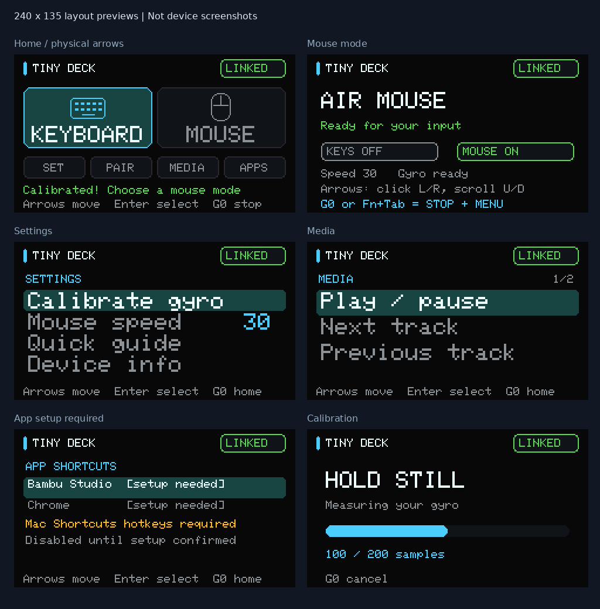

# Cardputer ADV AirDesk

Experimental BLE keyboard, gyro air mouse and media remote for **M5Stack
Cardputer ADV**. A 240×135 landscape interface makes Keyboard and Mouse explicit,
mutually exclusive modes. It is not intended for the original non-ADV Cardputer.



## Status

Source corresponds to the v7 prototype. It compiled and passed native logic tests
and sanitizers, and the application was installed with flash-hash verification.
Earlier prototype keyboard and air-mouse operation was user-tested on macOS.
The v7 interface received positive user feedback; exhaustive device validation of
all media actions, reconnect behavior and buffered-display performance is pending.

**Not production-ready.** App launch entries are intentionally disabled until
Mac-side shortcut setup is chosen and verified. No presentation or combined mode.
No external display support in this firmware. No binary or device backup included.

## Controls

- **G0:** stop host input and return to HOME. Holding G0 inhibits input.
- **Menus:** bare arrow-position keys navigate; Enter selects. No W/S navigation.
  HOME left/right moves within a row; up/down switches rows. Lists follow focus.
- **Keyboard:** normal typing, Shift capitalization and symbols. Fn+1…0 gives
  `!@#$%^&*()`, Fn+- gives `_`, Fn+= gives `+`, replacing Fn function-key aliases.
  Opt maps to macOS Command and Alt maps to Option. Enter sends Enter, Backspace
  deletes backward, Fn+Backspace deletes forward. Fn+backtick sends Escape.
- **Mouse:** gyro motion moves cursor. The printed left/right arrow positions
  (comma/slash) hold left/right mouse buttons. Up/down (semicolon/period) scroll.
  There is no Fn mouse layer. In Keyboard mode these keys type punctuation.
- **Settings:** calibrate on a still surface; adjust mouse speed; guide and info.
  Calibration gives 1 second to settle, then collects 200 samples (~2 seconds).
- **Pair:** advertise `Tiny Deck ADV Combo` for 120 seconds. The legacy name is
  retained for compatibility; it does not mean both modes can run together.
- **Media:** arrow keys select play/pause, next, previous, volume up/down or mute.
  Enter requests a consumer-control pulse. Host/app behavior is not guaranteed.

Fn+Tab also stops input and opens HOME. There are no Fn+K/Fn+Space mode toggles.
A selected mode waits for every key to be released before emitting host input.
Disconnect/reconnect returns to a stopped menu rather than resuming motion.

## Build and test

Use PlatformIO Core with Python, and a C++17 compiler for native tests:

```sh
python -m venv .venv
. .venv/bin/activate
pip install platformio==6.2.0
pio run
bash test.sh
```

`platformio.ini` pins Espressif32 6.12.0, M5 library revisions and IRremote 4.7.1.
The target uses Arduino ESP32 2.0.17 and an 8MB default partition layout.
Build uses about 1.16MB flash and 49.5KB static RAM; the display framebuffer
requires another 64,800 bytes dynamically. A failed framebuffer allocation
prevents HID startup.

Native tests cover math, calibration, mode/release guards, keyboard reports,
mouse controls, navigation, consumer masks and timer boundaries. They do not
simulate BLE callbacks, physical IMU data, LCD refresh or macOS behavior.

**Do not blindly upload.** See [hardware and recovery](docs/HARDWARE.md) before
writing any device. A generic PlatformIO upload may replace bootloader and
partitions as well as the application. Never use an app-only offset without
verifying the installed layout first.

## Design

A checked RAM framebuffer composes each screen before sending it to the LCD,
avoiding deliberately visible clear/redraw intermediate frames. Menu key changes
request immediate refresh. Two large mode tiles, single focus highlight,
selection-following Media pages and a persistent G0 legend favor legibility.
See [research and limitations](docs/DESIGN_RESEARCH.md). The preview is a layout
rendering, not a hardware screenshot. Color contrast calculations are not a
measurement or certification of the physical LCD.

## Mac app-launch setup

APPS currently shows Bambu Studio and Chrome as setup-needed and sends no keys.
The proposed mechanism is two macOS Shortcuts using **Open App**, each with a
verified unused global keyboard shortcut, followed by adding those exact chords
to the firmware. This avoids typing commands or app names into unknown focused
windows. No host configuration is changed by this firmware.

[Apple: run a shortcut while working on your Mac](https://support.apple.com/en-lamr/guide/shortcuts-mac/apd163eb9f95/mac)

## Safety and security

Use only with devices you own or have permission to control. Test on an idle,
non-sensitive desktop first; gyro drift can cause unintended cursor actions.
Keep G0 accessible. No keystroke logging, network exfiltration, Wi-Fi control,
application-level secret storage or automatic app-launch macros are implemented.
Bluetooth bond keys may be stored by the ESP32 BLE framework.

BLE bonding uses no-input/no-output pairing, without passkey confirmation or
strong protection against a nearby attacker during pairing. Only open Pair in a
trusted environment and verify the selected host. Do not use this experimental
firmware for sensitive or safety-critical control. Adding media report3 can cause
cached-host HID descriptors; user-managed re-pairing may be required.

## Attribution and licensing

Developed for [@faizanchundrigar](https://github.com/faizanchundrigar) with AI
assistance. Dependencies remain separate and retain their upstream authorship
and licenses; see [third-party notices](THIRD_PARTY_NOTICES.md).

No project-wide license has been selected. Public visibility is not a grant of
an open-source license. The included font notice applies only to the referenced
font/preview material. No endorsement by M5Stack, Apple or Bambu Lab is implied.
